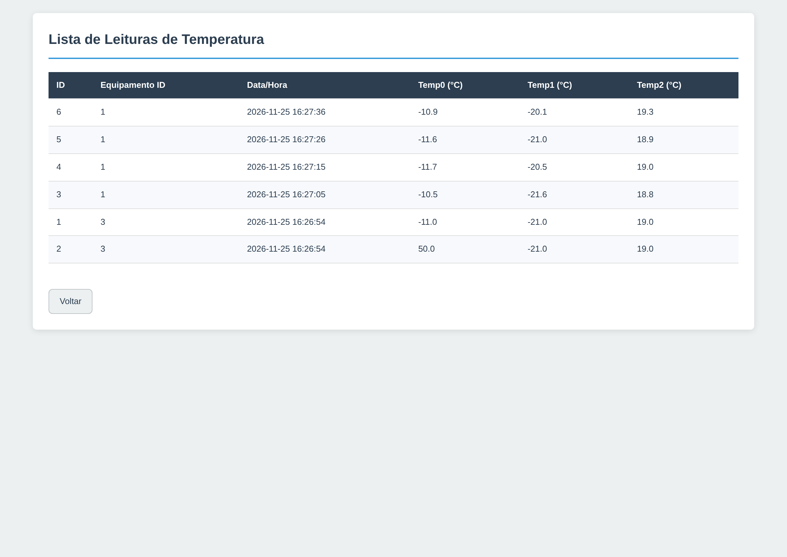

# Refrigeration equipment monitoring — Flask REST API

Web application for managing clients and refrigeration equipment, receiving temperature readings from **simulated** sensors and logging alerts when readings fall outside configured limits. It includes a Flask REST API with JWT authentication, a SQLite database with equipment ownership history, server-rendered pages and a JavaScript front end, and Swagger documentation.

Academic pair project for the *Web Programming* course (CTeSP in Web and Mobile Development, IPLUSO — Instituto Politécnico da Lusofonia, Lisbon).

## Authors and origin

- **Base project:** José Guerreiro Faísca (lecturer), who provided the starting code for the course. Files that keep his name in their header (`scripts/create_db.py`, `scripts/teste_sistema.py`) and the "(base)" credit in other files are preserved.
- **Project work:** Pedro Caldeira and Tiago Sebastião, who extended the base into the system described below. The work was shared between the two students.

No licence is included: the base code belongs to its author and is published here only as part of this academic project. If you are the author of any part of this code and want it changed or removed, please open an issue.


## Features

- **Clients and equipment:** create and list clients (identified by NIF) and equipment (serial number), through HTML forms and the JSON API.
- **Equipment life cycle:** `GET`, `PUT`, `PATCH` and `DELETE` on `/api/equipamentos/<id>`. `PATCH` transfers a unit to another client by closing the current ownership record and opening a new one at the same instant, so the ownership history is kept without gaps or overlaps. `PUT` replaces the serial number and owner; a serial number already used by another unit is rejected with `409 Conflict`. Both run in a single database transaction, so a failed request changes nothing. Deleting a unit removes its dependent records through `ON DELETE CASCADE`.
- **Temperature readings:** `POST /temperatura` accepts JSON readings with three sensor values (`temp0`, `temp1`, `temp2`); the CSV format of the original base is still accepted.
- **Alerts:** acceptable ranges per sensor are stored in the `limites_sensores` table. After answering the request, the server checks each reading in a background thread and writes out-of-range values to `alertas_sensores`.
- **Authentication:** `POST /api/auth/login` returns a JWT (valid for 24 h); write operations and the alerts endpoints require `Authorization: Bearer <token>`.
- **API documentation:** Swagger UI generated with Flasgger at `/api/docs`.
- **Front end:** Jinja2 templates plus a static page that calls the API with `fetch` and updates the DOM (delete and transfer without reloading). CSS includes a single-column layout for screens up to 640 px.
- **Sensor simulator:** `client_temp/temp_rand_main.py` logs in, then sends random readings for one unit every 10 seconds, within the configured normal ranges (`temp0` −28…−18 °C, `temp1` −20…−10 °C, `temp2` 0…50 °C).
- **Verification script:** `scripts/teste_sistema.py` creates sample data through the API, sends a normal reading (expects no alert) and an anomalous one (expects one alert), lists the alerts and checks some HTTP status codes.
- **Regression tests:** `tests/` contains `pytest` tests that use Flask's test client and a temporary database.

| Equipment list | Temperature readings |
|---|---|
|  |  |


*Screenshots taken from this repository's code running locally with the sample data.*

## Project structure

```
server_main/        Flask server (server_main.py), templates and static files
client_temp/        temperature sensor simulator
scripts/            database creation, verification script and its sample data
tests/              pytest regression tests
db/                 SQLite schema (5_IMPLEMENTACAO_v3.sql)
```

## Setup and run

Requires Python 3.10+.

```bash
python -m venv .venv
source .venv/bin/activate          # Windows: .venv\Scripts\activate
pip install -r requirements.txt
```

Configuration is read from environment variables (see `.env.example`):

| Variable | Purpose | Default |
|---|---|---|
| `MONITOR_ADMIN_USER` | login user name | `admin` |
| `MONITOR_ADMIN_PASSWORD` | login password | random, printed when the server starts |
| `MONITOR_JWT_SECRET` | key used to sign tokens | random on each start |
| `MONITOR_HOST` / `MONITOR_PORT` | server address | `127.0.0.1` / `8080` |
| `MONITOR_DEBUG` | Flask debug mode (`1` to enable) | off |

```bash
export MONITOR_ADMIN_PASSWORD='choose-a-password'
export MONITOR_JWT_SECRET='a-long-random-string'

python scripts/create_db.py           # creates db/monitor.db with sample data (fictitious companies)
python server_main/server_main.py     # http://127.0.0.1:8080  ·  API docs: /api/docs
```

In other terminals, with the same environment variables:

```bash
python client_temp/temp_rand_main.py 1   # send simulated readings for equipment ID 1
python scripts/teste_sistema.py          # run the verification script
```

### Tests

The regression tests do not need a running server:

```bash
pip install -r requirements-dev.txt
pytest
```

They cover: `PUT` with a serial number that already exists (409, nothing changed), a valid `PUT`, several consecutive `PATCH` transfers (history stays ordered and contiguous, exactly one open record), a transfer to an unknown client (404, nothing changed), and normal vs. anomalous readings (simulator ranges and verification-script samples inside the configured limits; a normal reading creates no alert, an anomalous one creates exactly one).

### Example API calls

```bash
TOKEN=$(curl -s -X POST http://127.0.0.1:8080/api/auth/login \
  -H 'Content-Type: application/json' \
  -d "{\"utilizador\":\"admin\",\"password\":\"$MONITOR_ADMIN_PASSWORD\"}" | python -c "import sys,json;print(json.load(sys.stdin)['token'])")

# transfer equipment 1 to another client
curl -X PATCH http://127.0.0.1:8080/api/equipamentos/1 \
  -H "Authorization: Bearer $TOKEN" -H 'Content-Type: application/json' \
  -d '{"Cliente_NIF":"987654321"}'

# list alerts
curl -H "Authorization: Bearer $TOKEN" http://127.0.0.1:8080/api/alertas
```

## Verification

Checked from a fresh clone, following this README (Python 3.13, package versions resolved from `requirements.txt`): see the commit history for the date. The regression tests pass with `pytest`, and against a running server `scripts/teste_sistema.py`, the sensor simulator, login, `PUT`, `PATCH` and `DELETE` behave as described above.

`teste_sistema.py` is a verification script that runs against a live server; the `tests/` suite is the automated part.

## Changes from the submitted version

Made for publication:

- the login credentials and JWT signing key, previously fixed in the code, are read from environment variables (also in the simulator and verification script), and the login form no longer pre-fills the password;
- the server listens on `127.0.0.1` with debug mode off by default (both configurable);
- student numbers were removed from file headers;
- the generated database, the project report and editor/cache files were not included; `requirements.txt` and `.env.example` were added.

Fixes made after publication:

- `PUT` with a serial number already used by another unit returned `500` (unhandled `sqlite3.IntegrityError`); it now returns `409` and the request changes nothing;
- two quick `PATCH` transfers could record an ownership end (`DataFim`) earlier than its start (`DataInicio`), because each new record started one second after the transfer time and server times were local while database defaults are UTC; transfers now close and open records at the same UTC instant, never before the current record's start, inside one transaction;
- the simulator's normal ranges and the verification script's "normal" sample were outside the configured limits for `temp0` and `temp1`, so they produced alerts; both now use values inside the limits, and the script checks the number of alerts produced;
- `pytest` regression tests were added for these cases.

## Known limitations

- Single demo user; no user management.
- The server emits a Socket.IO event when temperatures are listed, but no page subscribes to it, so pages do not update by themselves.
- Runs on Flask's development server with SQLite; it is a course project, not a production deployment.
